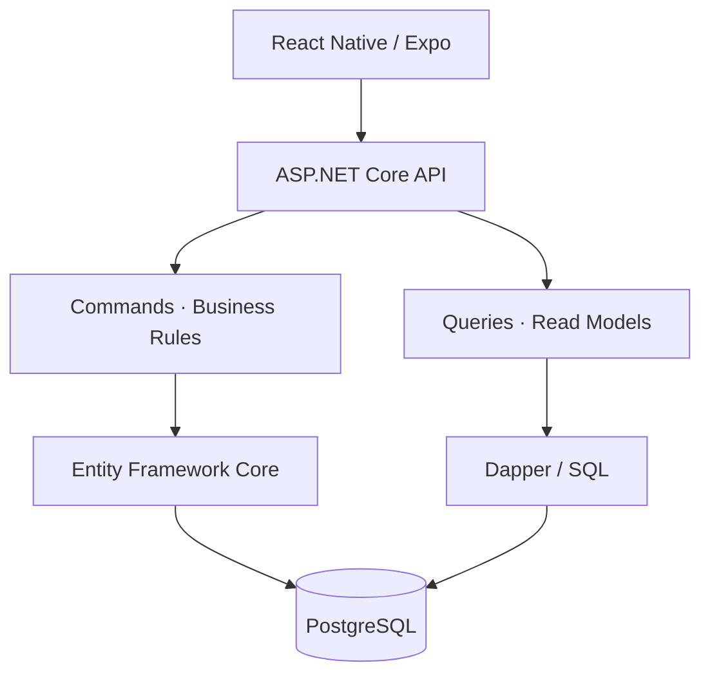

# WINRA7 — Personal Finance Tracker

**اعرف دراهمك وين راحو — Know where your money goes.**

WINRA7 is a mobile application that helps users track income and expenses, monitor their balance, and understand monthly spending.

Built with **.NET, React Native, and PostgreSQL**, it combines a modular backend with a multilingual mobile experience supporting **Arabic, French, and English**.

[Support](https://bouzianemohammedamin.github.io/winra7-support/) · [Privacy Policy](https://bouzianemohammedamin.github.io/winra7-support/privacy.html) · [Contact](mailto:winra7.support@gmail.com)

> This repository is the public project showcase and support hub. Application source code is maintained separately.

## Features

- **Income and expenses:** create, edit, and delete transactions.
- **Transaction history:** browse records by date, category, and transaction type.
- **Dashboard:** review income, expenses, remaining balance, and recent activity.
- **Monthly analytics:** understand spending through category breakdowns.
- **Account management:** registration, authentication, and profile preferences.
- **Localization:** Arabic with RTL support, French, and English.
- **Appearance:** light, dark, and system themes.
- **Privacy controls:** transaction deletion and account-deletion requests.

## My Role

I designed and developed WINRA7 end to end, covering:

- Backend architecture, business logic, and REST APIs.
- Database modeling, migrations, and SQL queries.
- Mobile screens, navigation, forms, and API integration.
- Authentication and session management.
- Unit and integration testing.
- Backend deployment and Android release preparation.

## Technology Stack

| Area | Technologies |
| --- | --- |
| Backend | C#, .NET 9, ASP.NET Core |
| Architecture | Modular Monolith, Clean Architecture, CQRS, Vertical Slices |
| Database | PostgreSQL, Entity Framework Core, Dapper |
| Mobile | React Native, Expo, TypeScript, Expo Router |
| Server State | TanStack Query, Axios |
| Forms & Validation | React Hook Form, Zod |
| Localization | i18next, Arabic RTL support |
| Authentication | JWT, refresh tokens, Expo SecureStore |
| Delivery | GitHub Actions, Render, Neon, Expo EAS Build |

## Backend Architecture

WINRA7 uses a **Modular Monolith**: one deployable backend organized into independent business modules with explicit responsibilities and contracts.

| Module | Responsibility |
| --- | --- |
| Identity | Authentication and sessions |
| Users | Profiles and preferences |
| Transactions | Income and expense management |
| Categories | Categories and subcategories |
| Analytics | Financial summaries and spending reports |
| Subscriptions | Feature entitlements and usage limits |
| AI | Integration boundaries for parsing and transcription |

### Clean Architecture

Modules separate business rules from application orchestration and infrastructure:

- **Domain:** entities, value objects, and business invariants.
- **Application:** use cases, commands, queries, and handlers.
- **Infrastructure:** persistence and external service integrations.
- **Contracts:** interfaces and data exchanged between modules.

The API host handles HTTP concerns and dependency injection. Modules communicate through contracts rather than accessing each other's internal implementation.

### CQRS & Data Access

Read and write operations follow separate paths:

- **Commands** apply business rules and persist changes through **Entity Framework Core**.
- **Queries** use **Dapper** and parameterized SQL to return focused read models.
- Both operate on the same **PostgreSQL database**.

This approach keeps transaction workflows explicit while allowing reporting queries to retrieve only the data they need.

## Mobile Architecture

The mobile application is organized by feature, with shared infrastructure for authentication, networking, localization, and theming.

- **Expo Router** manages navigation.
- **TanStack Query** manages server state and account-scoped query caching.
- **Axios** centralizes HTTP requests and authentication headers.
- **Zod** validates forms and API responses at runtime.
- **Expo SecureStore** provides secure local credential storage.
- Shared components keep styling and interaction consistent across screens.

Session handling includes token refresh, bounded retries, and cancellation of stale requests when the active session changes.

## Testing

Testing focuses on business correctness and integration behavior.

### Unit Tests

Cover isolated business rules and application logic, including transaction validation, monetary values, and feature-access decisions.

### Integration Tests

Cover database persistence and query behavior, including EF Core mappings, transaction operations, and financial aggregations.

### Quality Focus

- Authenticated users can access only their own financial records.
- Transaction dates retain date-only semantics.
- Financial totals are calculated deterministically.
- Invalid input is handled consistently.
- Module dependencies remain aligned with architectural boundaries.

## Engineering Decisions

- **Module ownership:** each business module owns its persistence and exposes explicit contracts.
- **Financial correctness:** monetary values retain currency context; balances come from persisted transactions and deterministic calculations.
- **Runtime validation:** API payloads are checked before reaching mobile components.
- **Separation of concerns:** UI, application workflows, domain rules, and infrastructure have distinct responsibilities.
- **Localization from the start:** language, formatting, and RTL behavior are centralized.
- **Practical deployment:** a modular backend keeps operations manageable without introducing distributed-service complexity.

## Deployment

- **API:** Render.
- **Database:** PostgreSQL on Neon.
- **Backend deployment:** GitHub Actions.
- **Android builds:** Expo EAS Build.
- **Distribution:** Google Play testing and production release workflow.
- **Support website:** GitHub Pages.

## Roadmap

- Voice-assisted transaction entry.
- Natural-language transaction parsing.
- Subscription-based feature access.
- Additional financial reports.
- iOS distribution.

The initial public release focuses on manual transaction tracking and analytics.

## Author

**Mohammed Amin Bouziane**  
.NET & React Native Developer

[GitHub](https://github.com/BouzianeMohammedAmin) · [Contact](mailto:winra7.support@gmail.com)
